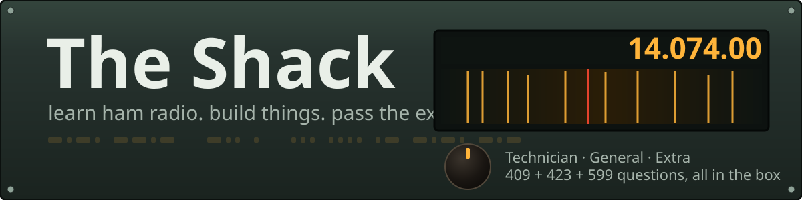
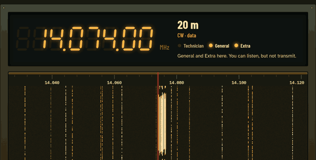
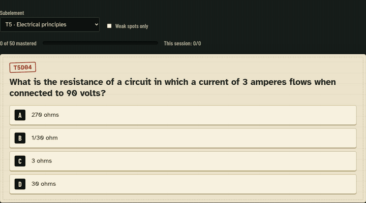
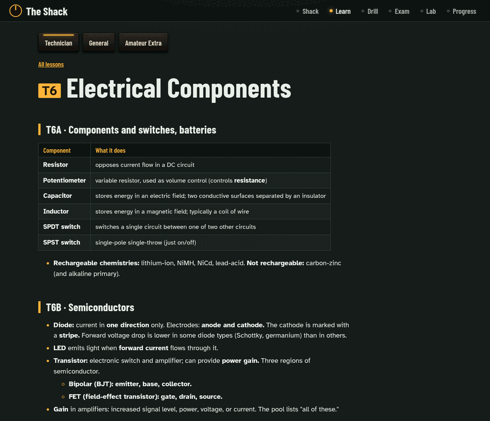
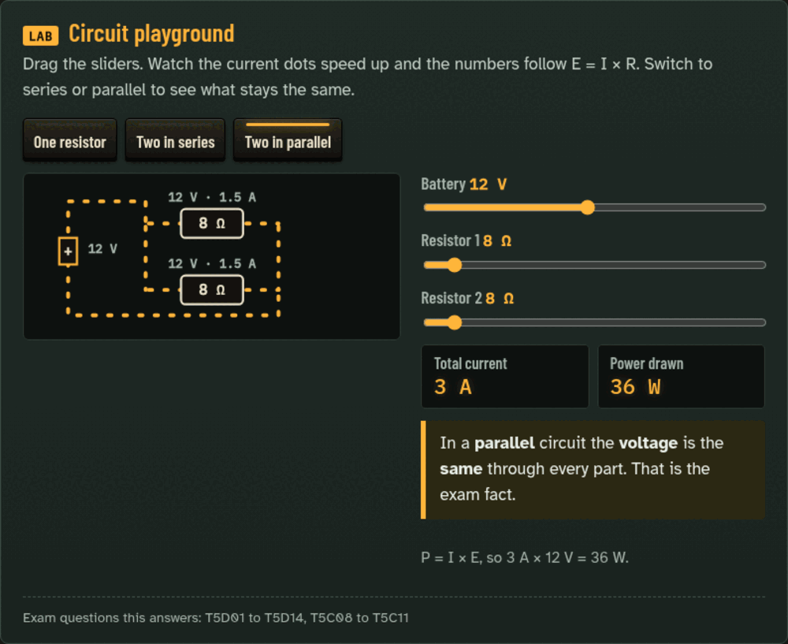
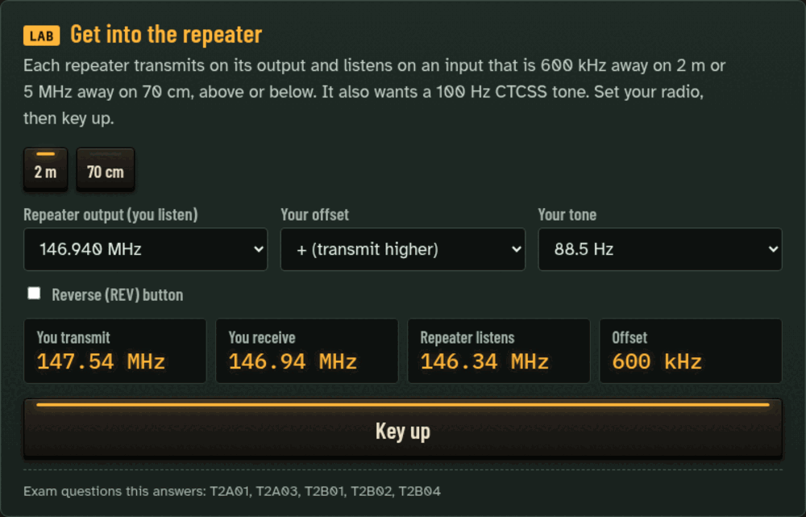
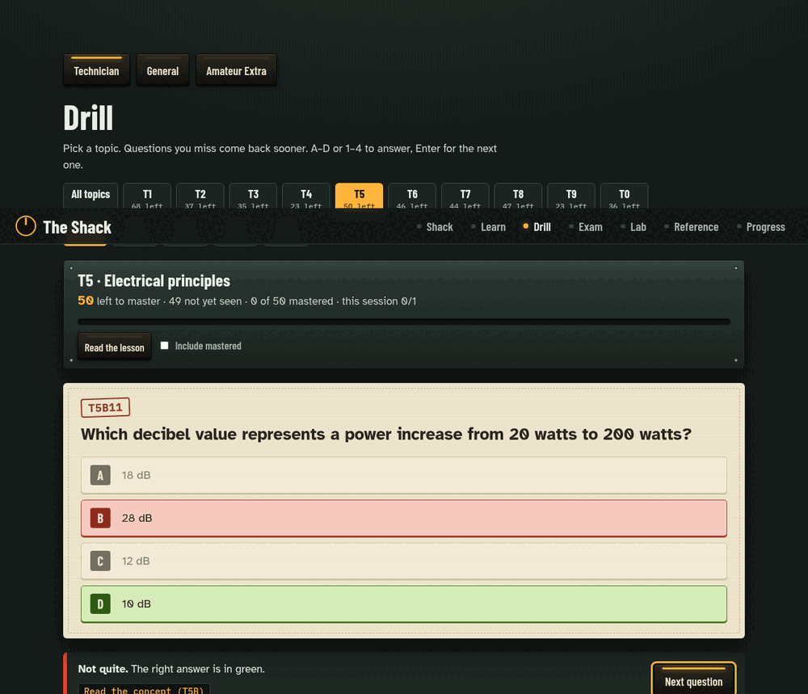
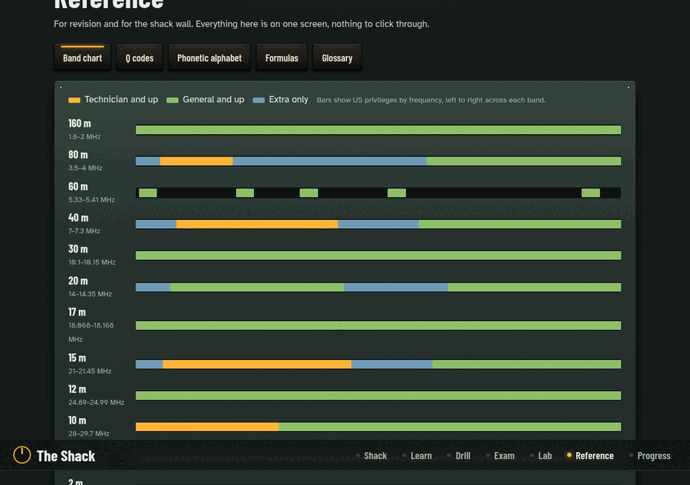
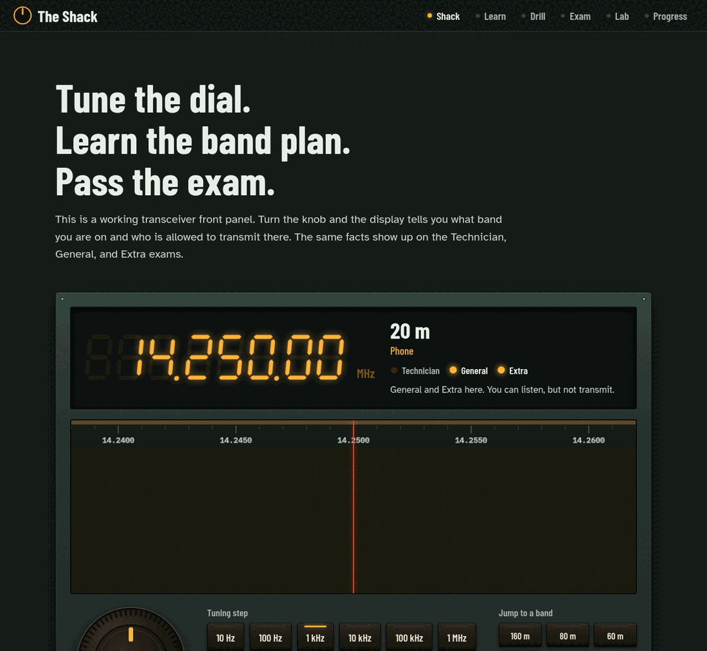
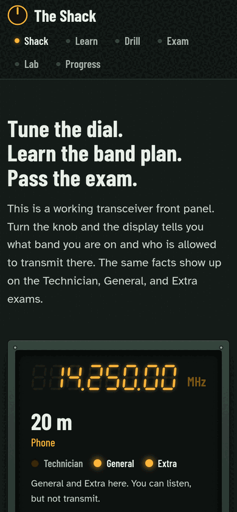

<p align="center">
  
</p>

<p align="center">
  
  
  
  
  
</p>

# CQ CQ CQ, this is the shack

A home base for everything ham radio: **pass the exams, then build things on the air.**

### 👉 Live site: **[ham-shack-smoky.vercel.app](https://ham-shack-smoky.vercel.app)**

It started as "give me everything I need to pass the Technician exam" and grew into a small lab:

* **Study guides as PDFs** for Technician, General, and Extra, kept separate, each with the *entire* question pool and answers in the back.
* **An interactive site** (`site/`) built around a working transceiver front panel. Turn the knob, watch a waterfall, learn who may transmit where.
* **A `projects/` bench** for the fun part that comes after the license: SDR, APRS, antennas, keyers, satellites.

If you are studying for the same exam, this repo is meant to be forked, poked at, and improved. Found a wrong fact? Open an issue or send a patch. That is how ham radio has always worked.

---

## The Shack (the interactive site)

<p align="center">
  
</p>

The home page *is* the radio. The seven-segment display, the tuning knob, and the waterfall are all live:

| | |
|---|---|
| **Tuning dial** | Drag the knob in circles, scroll over it, or use arrow keys. The readout names the band, the mode segment, and which license classes may transmit there. |
| **Privilege ribbon** | The strip above the waterfall is green where *your* license class may transmit. Switch between Technician, General, and Extra and watch the band plan change. |
| **Waterfall** | CW streaks, SSB blobs, FM carriers, a 10 m beacon, WWV ticks, and an FT8 cluster on 14.074. Click any trace to tune to it. |
| **Audio** | Hit "Turn on audio" and the same signals become Web Audio: CW you can actually copy, garbled SSB, FT8 warble, band noise. |
| **Tuning quests** | "Find the 2 m calling frequency." "Land inside the 10 m beacon sub-band." Each one is a real exam question in disguise. |
| **Learn** | The study guide as lessons, with a **topic sidebar** always on screen, a big "All topics" button, Elmer's notes, photos, and **under every group heading**: the official syllabus topic, the **FCC rules behind its questions (linked to ecfr.gov)**, and a button to practice just that group. |
| **Concept labs** | Nine hands-on explainers inside the lessons: a circuit playground (Ohm's law, series vs parallel), decibel slider, wavelength and antenna length, polarization, a day/night skywave explorer, an SWR/feed line lab, modulation bandwidth, a "get into the repeater" simulator, and a schematic-symbol quiz. Each lists the exam questions it answers. |
| **Drill** | Topic chips with **questions left** per topic and per group, spaced repetition (Leitner boxes), "topic cleared" screens, and the rule section behind every answer. Keys: A to D to answer, Enter for next. |
| **Antenna workshop** | Types and what each is good for (with photos and radiation patterns), a **"which antenna should I use" picker**, a cut-length calculator, a **trim-the-dipole SWR lab**, and three cheap builds: a 2 m ground plane (~$10), a roll-up ladder-line J-pole (~$15), and a 10 m dipole (~$20) where Technicians can use voice. Also feed lines, troubleshooting and safety. |
| **Reference** | One-screen revision: a US band chart colored by license class, Q codes, phonetic alphabet, formulas and prefixes, and a searchable glossary. |
| **Mock exam** | Exactly how a VE team builds it: **one question from every question group**. 35 questions and 26 to pass for Technician and General, 50 and 37 for Extra. |
| **Lab** | Morse trainer (Koch method), Ohm's law, wavelength and antenna lengths, decibels, phonetic alphabet. |
| **Progress** | An analog S-meter that swings as you master the pool. Everything stays in your browser. |

<p align="center">
  
</p>

<details open>
<summary>More screenshots</summary>
<br>
<p align="center">
  <br><br>
  <br><br>
  <br><br>
  <br><br>
  <br><br>
  <br><br>
  
</p>
</details>

### Run it

```bash
cd site
npm install
npm run dev        # http://127.0.0.1:5173
npm run build      # static files in site/dist, host anywhere
```

It is a static site with hash routing, so any file host works. The live copy runs on Vercel. `vercel.json` at the repo root sets the build (`cd site && npm run build`, output `site/dist`), so deploying is one command from the repo root:

```bash
vercel deploy --prod
```

---

## Study guides (PDF)

One PDF per license class. They are separate on purpose: you do not need Extra theory to pass Technician.

| Class | Guide | Exam | Question pool | Valid for exams |
|---|---|---|---|---|
| **Technician** | [Technician-Study-Guide.pdf](study-guides/technician/Technician-Study-Guide.pdf) | 35 questions, 26 to pass | 409 questions | Jul 1 2026 to Jun 30 2030 |
| **General** | [General-Study-Guide.pdf](study-guides/general/General-Study-Guide.pdf) | 35 questions, 26 to pass | 423 questions | Jul 1 2023 to Jun 30 2027 |
| **Amateur Extra** | [Extra-Study-Guide.pdf](study-guides/extra/Extra-Study-Guide.pdf) | 50 questions, 37 to pass | 599 questions | Jul 1 2024 to Jun 30 2028 |

Not tied to a license class: the **[Antenna Handbook](study-guides/antennas/Antenna-Handbook.pdf)** (types, what each is good for, three cheap builds).

Each PDF has a cover, the study guide (written from the pool, one section per subelement, with a cram sheet), and an appendix with **every question, the right answer, and its CFR reference**, grouped the way the exam is built.

The guides are Markdown in `study-guides/<class>/<class>-guide.md`. Edit the Markdown, then rebuild:

```bash
cd site && npm install && cd ..    # once, for the fonts
python3 scripts/build_pdfs.py      # all three
python3 scripts/build_pdfs.py technician
```

Needs `pandoc` and `chromium` on your PATH.

### Passing Technician in a paragraph

Read the Technician guide once. Register for a free FCC Registration Number (FRN) before exam day. Drill one subelement a day in the app until you stay above 80 percent, then take full mock exams until you score 30 or better three times in a row. Real-exam nerves cost two or three questions, so build that cushion. Bring photo ID, your FRN, and a pencil.

---

## How complete is it? (measured, not promised)

`python3 scripts/audit_coverage.py technician` checks every pool question: does the guide's section for that subelement state the correct answer?

| Class | Questions whose answer is stated in the guide | Verdict |
|---|---|---|
| **Technician** | 367 of 409 pass the automatic check. The other 42 were read by hand: all are phrasing or notation differences (for example "Ω" against "ohm"), none is a missing concept. | Complete against the pool. Every "all these choices are correct" question now lists each choice. |
| **General** | 81 of 423 | Condensed summary. The Drill and Mock exam cover the whole pool, the guide does not teach every question. |
| **Extra** | 146 of 599 | Condensed summary, same caveat. |

Stated plainly: Technician is concept-complete against the 2026 to 2030 pool. General and Extra are not yet, and the site says so on those lessons. Expanding them to Technician depth is the next big job. A check like this proves the facts are *present*, not that they *click*, so the labs and Elmer's notes carry the "why".

## What is in the box

```
ham-radio/
├── README.md
├── CLAUDE.md                 notes for AI pair-programming sessions in this repo
├── data/                     question pools (JSON), exam figures, official syllabus group titles,
│                             Part 97 section names, photo credits
├── study-guides/
│   ├── technician/           guide (.md) and PDF
│   ├── general/
│   ├── extra/
│   └── antennas/             the Antenna Handbook (guide + PDF)
├── site/                     the interactive web app (React + Vite)
├── scripts/
│   ├── build_pdfs.py         Markdown + pool -> styled PDF via pandoc and Chromium
│   ├── build_groups.py       group titles + FCC rule sections per group -> data/groups.json
│   ├── audit_coverage.py     does the guide actually teach each question?
│   ├── fetch_images.py       finds and downloads freely-licensed photos, records credits
│   └── make_banner.py        regenerates the animated banner above
├── projects/                 your ham builds go here (see below)
├── assets/                   banner, GIFs, screenshots
└── .claude/skills/           agent skills for the site and for embedded ham projects
```

## `projects/`: after the license

Passing the exam is the starting line. This folder is the bench for what comes next. Each project gets its own directory with a README that says what it is, what hardware it needs, and which license class it requires to transmit. Start from `projects/_template/`.

Ideas to steal:

* **RTL-SDR waterfall in the terminal**, then decode ADS-B and weather satellites (receive only, no license needed)
* **APRS tracker** on an ESP32 or Raspberry Pi
* **Satellite pass predictor** that reads Keplerian elements and plans ISS and FM-sat passes
* **FT8 station** with a Raspberry Pi and a sound card interface
* **Antenna calculators and NEC models** for your own yard
* **CW keyer** on a microcontroller, with a paddle you 3D-print
* **Contest log parser** that turns Cabrillo files into stats

---

## Honest fine print

* **Rule links** go to the live text on [ecfr.gov](https://www.ecfr.gov/). Section titles in `data/part97-sections.json` are plain-English labels; the eCFR text is the authority.
* **Check dates.** Question pools rotate every four years (Technician in 2026, General in 2027, Extra in 2028). Confirm the pool in force with your VE team or at [ncvec.org](https://ncvec.org/) before your exam. The Technician data here includes the NCVEC errata of February 19, 2026.
* **The study guides are my own words, not the official pool text.** The pool itself is the authority; the appendix reproduces it. If a guide statement and the pool disagree, the pool wins. Please file an issue.
* **Frequencies in the simulator** follow US Part 97 privileges as of the pools above. The signals are simulated. Do not treat the simulator as a legal reference; the FCC rules are.
* **Not affiliated** with the FCC, NCVEC, ARRL, or any VEC.

## Credits and sources

* Question pools: **NCVEC Question Pool Committee** ([Technician 2026 to 2030](https://ncvec.org/index.php/2026-2030-technician-question-pool), public domain). Announcement: [ARRL](https://www.arrl.org/news/new-technician-class-question-pool-released-effective-july-1-2026).
* Machine-readable pools and exam figures: [russolsen/ham_radio_question_pool](https://github.com/russolsen/ham_radio_question_pool) (Apache-2.0). See `NOTICE`.
* Photos: [Wikimedia Commons](https://commons.wikimedia.org/) (public domain, CC0, CC BY, CC BY-SA) and NASA. Every photo shows its author and license under it, and the site has a full credits page. `scripts/fetch_images.py` refuses anything that is not freely licensed.
* Official group titles: NCVEC Technician syllabus (Feb 19 2026 revision).
* Fonts: Barlow Condensed, Atkinson Hyperlegible, IBM Plex Mono (SIL OFL) via Fontsource.


Code, guides, and design are MIT licensed (see `LICENSE`). 73, and see you on the air.
